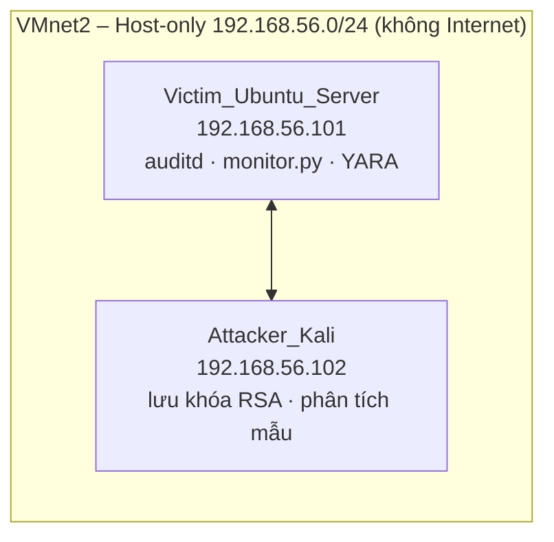

# INS3201 – Ransomware & System Recovery

> Đồ án thực hành môn **Điều tra số và phản ứng với sự cố (INS3201)** – **Nhóm 2**
> Giảng viên hướng dẫn: **Ths Nguyễn Thái Cường**

Mini Lab mô phỏng chuỗi **phát hiện → điều tra → ứng cứu → khôi phục** một sự cố ransomware trên Linux, chạy hoàn toàn trong môi trường máy ảo **VMware Workstation** cô lập (mạng Host-only, không Internet).

---

## 👥 Thành viên

| STT | Họ và tên | MSSV|
|----|-----------|---------------------|
| 1 | Đào Thị Huyền Chi | 23070379 |
| 2 | Lê Thành Trung | 23070172 |
| 3 | Vũ Thị Thu Hương | 23070428 |
| 4 | Phạm Tiến Thuận | 23070311 |

---

## 🎯 Mục tiêu

- Dựng hạ tầng Mini Lab cô lập gồm 2 VM: **Victim** (Ubuntu Server 22.04) và **Attacker** (Kali Linux).
- Hiểu cơ chế mã hóa lai **AES-256-CBC + RSA-2048** mà ransomware thường dùng (ở mức khái niệm) và viết công cụ **khôi phục** dữ liệu.
- Xây dựng hệ thống **giám sát thời gian thực** bằng `auditd` + `monitor.py`, cảnh báo khi có hành vi đổi tên file hàng loạt.
- Thực hành **điều tra số**: truy vết bằng `ausearch`, viết luật **YARA**, đóng gói chỉ số mối đe dọa theo **STIX 2.1**, dựng **Incident Timeline**.
- Xây dựng **Playbook ứng cứu OASIS CACAO v1.0** và thực hành khôi phục bằng khóa giải mã hoặc **snapshot rollback**.

---

## ⚠️ Lưu ý an toàn

- Repo **không chứa mã nguồn ransomware chạy được** (`encrypt.py`). Cơ chế mã hóa chỉ được mô tả bằng pseudocode / giải thích từng bước.
- Để kích hoạt chuỗi phát hiện, nhóm dùng `simulate_events.py`: chỉ **đổi tên file hàng loạt**, không đọc/ghi/phá hủy nội dung, có thể hoàn tác bằng `--undo`.
- Toàn bộ thử nghiệm chạy trong mạng **Host-only (VMnet2)**, **tắt DHCP**, không NAT/Bridge. Kiểm tra: từ Victim `ping 8.8.8.8` phải **timeout**.
- Không commit khóa riêng RSA (`rsa_private_key.pem`) lên git.

---

## 🧱 Kiến trúc Lab



| Máy ảo | Hệ điều hành | Cấu hình | IP |
|--------|--------------|----------|----|
| Victim_Ubuntu_Server | Ubuntu Server 22.04 LTS | 2 vCPU · 4 GB RAM · 30 GB | 192.168.56.101 |
| Attacker_Kali | Kali Linux 2023.x/2024.x | 2 vCPU · 2 GB RAM · 20 GB | 192.168.56.102 |

---

## 🗂️ Cấu trúc repo (đề xuất)

```
.
├── README.md
├── docs/
│   ├── Huong_dan_thuc_hanh_VMware.pdf     # Tài liệu hướng dẫn lab
│   ├── bao_cao_nhom2.pdf                  # Báo cáo cuối kỳ
│   └── screenshots/                       # Ảnh chứng minh từng bước
├── config/
│   └── audit.rules                        # Luật auditd
├── scripts/
│   ├── decrypt.py                         # Khôi phục dữ liệu (có khóa RSA)
│   ├── monitor.py                         # Giám sát thời gian thực
│   └── simulate_events.py                 # Mô phỏng sự kiện an toàn (có --undo)
├── detection/
│   └── ransomware_detection.yar           # Luật YARA
├── intel/
│   └── threat_indicator.json              # STIX 2.1
├── playbook/
│   └── ir_playbook.json                   # CACAO v1.0
└── demo/
    └── link_video.md                      # Link video demo
```

---

## 🔬 Quy trình thực hiện (4 giai đoạn)

### Giai đoạn 0 – Hạ tầng
1. Tạo mạng **VMnet2** (Host-only, bỏ DHCP, subnet `192.168.56.0/24`) trong *Virtual Network Editor*.
2. Tạo 2 VM, cùng gắn vào VMnet2, gán **IP tĩnh** (`netplan` trên Ubuntu, `nmcli` trên Kali).
3. Cài công cụ trên Victim: `auditd`, `audispd-plugins`, `yara`, `tshark`, Python3 + `cryptography`.
4. Tạo thư mục dữ liệu thử `/home/ubuntu/data/` (30 file mẫu).
5. Chụp snapshot **`Baseline_Clean_State`** (VM → Snapshot → Take Snapshot).

### Giai đoạn 1 – Cơ chế mã hóa & khôi phục
Mô hình **Hybrid Encryption**: mỗi file dùng một khóa AES-256 + IV ngẫu nhiên; khóa AES được bảo vệ bằng RSA-2048 (OAEP). Cấu trúc file đầu ra:

```
[độ dài khóa mã hóa (2 byte)] [khóa AES mã hóa bằng RSA] [IV (16 byte)] [ciphertext]
```

`scripts/decrypt.py` đảo ngược đúng cấu trúc trên khi có khóa riêng RSA (đọc từ file `.pem`, không hardcode).

### Giai đoạn 2 – Giám sát & cảnh báo
- `config/audit.rules` theo dõi thư mục dữ liệu và các syscall `rename*`, `unlink*`.
- `scripts/monitor.py` đọc `/var/log/audit/audit.log`, cảnh báo **CRITICAL** khi có **N ≥ 20** lần rename trong cửa sổ **T = 5 giây**; ghi log tại `/var/log/ransomware_alert.log`.
- Kiểm thử bằng `simulate_events.py` (2 terminal: một chạy `monitor.py`, một chạy mô phỏng).

### Giai đoạn 3 – Điều tra số
- Trích dấu vết: `ausearch -k mass_rename`, `ausearch -k ransomware_monitor`.
- Quét mẫu bằng YARA: `detection/ransomware_detection.yar`.
- Đóng gói IOC theo **STIX 2.1** (`intel/threat_indicator.json`, hash tính bằng `sha256sum`).
- Dựng **Incident Timeline** từ timestamp thật của `ausearch`.

### Giai đoạn 4 – Ứng cứu & khôi phục
Theo playbook CACAO (`playbook/ir_playbook.json`):

1. **Cô lập mạng** (Disconnect adapter hoặc `ip link set ens33 down`).
2. **Diệt tiến trình** độc hại (`kill -9 <PID>` lấy từ auditd).
3. **Khôi phục dữ liệu**
   - Kịch bản A – *có khóa*: chạy `decrypt.py`.
   - Kịch bản B – *không có khóa*: rollback snapshot `Baseline_Clean_State`.
4. Bật lại mạng, xác nhận hệ thống sạch.

---

## ▶️ Hướng dẫn chạy nhanh (trên Victim VM)

```bash
# Terminal 1 – giám sát
sudo python3 scripts/monitor.py

# Terminal 2 – kích hoạt sự kiện thử nghiệm
python3 scripts/simulate_events.py

# Hoàn tác tên file
python3 scripts/simulate_events.py --undo

# Điều tra
sudo ausearch -k mass_rename --start today
cat /var/log/ransomware_alert.log
yara -r detection/ransomware_detection.yar /home/ubuntu/

# Rollback snapshot (trên máy host)
vmrun -T ws revertToSnapshot "<đường_dẫn>\Victim_Ubuntu_Server.vmx" "Baseline_Clean_State"
```

> `monitor.py` cần chạy với `sudo` để đọc được `audit.log`.

---

## 🛠️ Công nghệ sử dụng

VMware Workstation Pro · Ubuntu Server 22.04 · Kali Linux · Python 3 (`cryptography`) · auditd · YARA · tshark · STIX 2.1 · OASIS CACAO v1.0 · OBS Studio

---

## ✅ Checklist sản phẩm( dự kiến)

- [ ] `decrypt.py` chạy thử thành công (có ảnh/video)
- [ ] `audit.rules` nạp thành công (`auditctl -l`)
- [ ] `monitor.py` phát hiện đúng ngưỡng N=20 / T=5s
- [ ] `ransomware_detection.yar` quét được mẫu thử
- [ ] `threat_indicator.json` (STIX 2.1) có hash thật
- [ ] `ir_playbook.json` (CACAO v1.0)
- [ ] Bảng Incident Timeline với timestamp thật
- [ ] Video demo 4 phân cảnh
- [ ] Snapshot `Baseline_Clean_State` còn tồn tại (có ảnh Snapshot Manager)

---

## 🎬 Video demo ( dự kiến)

| Phân cảnh | Nội dung |
|-----------|----------|
| 1 | Chạy `simulate_events.py` trên Victim VM |
| 2 | `monitor.py` in CRITICAL ALERT thời gian thực |
| 3 | `ausearch`, `yara` trích dấu vết, dựng Timeline |
| 4 | `decrypt.py` khôi phục file hoặc rollback snapshot |

🔗 Link video: _(điền)_

---

## 📄 Ghi chú

Dự án phục vụ **mục đích học tập** trong môi trường cô lập. Không sử dụng các kỹ thuật trong repo này trên hệ thống thật hoặc không được cấp phép.
